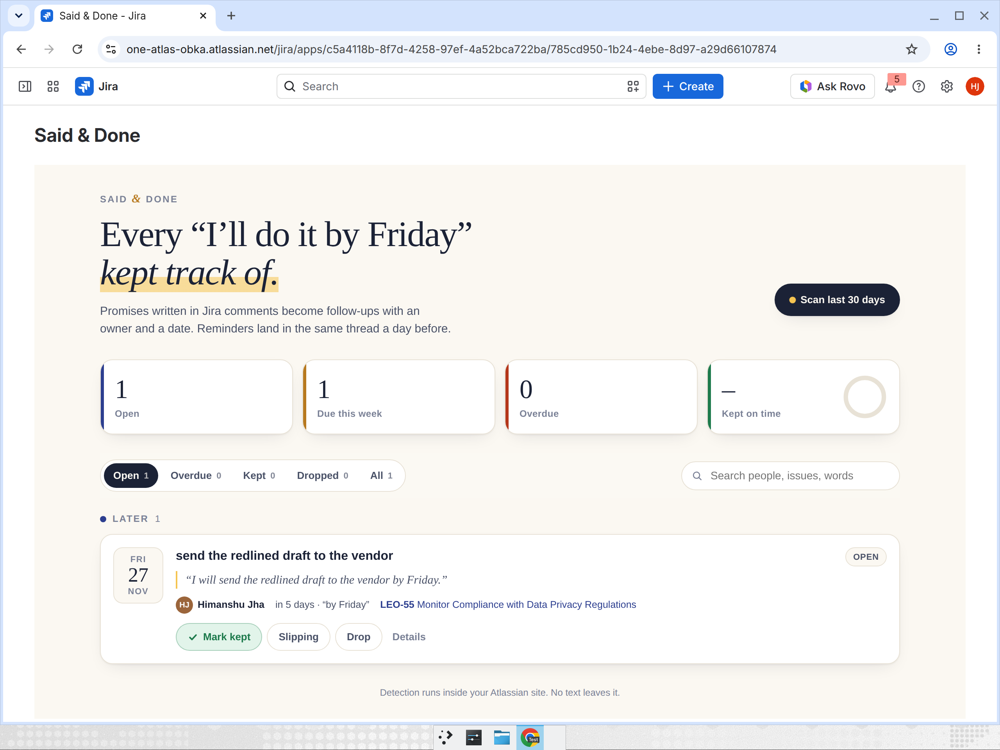

# Said & Done

**Promises in Jira and Confluence get buried before anyone follows up.**

Said & Done gives a promise an owner and a due date, tracks replies, and sends
reminders in the original conversation. Use **Mine** to see your own follow-ups
and **Not a promise** to dismiss a false match.

## How it uses Atlassian

Forge listens for Jira and Confluence changes, stores follow-ups in Forge KVS,
and runs scheduled reminders. The Jira issue panel, Confluence byline, and
ledger show the same state. Detection uses the text and dates on the site.

## Quickstart

From a fresh clone with Node 22 or newer:

~~~sh
npm ci && npm run build:ui
~~~

For a live test, use the judge build linked from Devpost. See
[setup and examples](docs/development.md).

[Video](https://youtu.be/_fGu7I4yyG0) · [Devpost](https://devpost.com/software/said-done-fmg1ez) ·
[Privacy](PRIVACY.md)

This repository has no license file.
