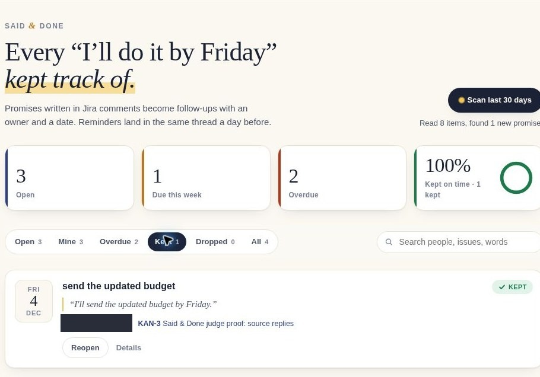
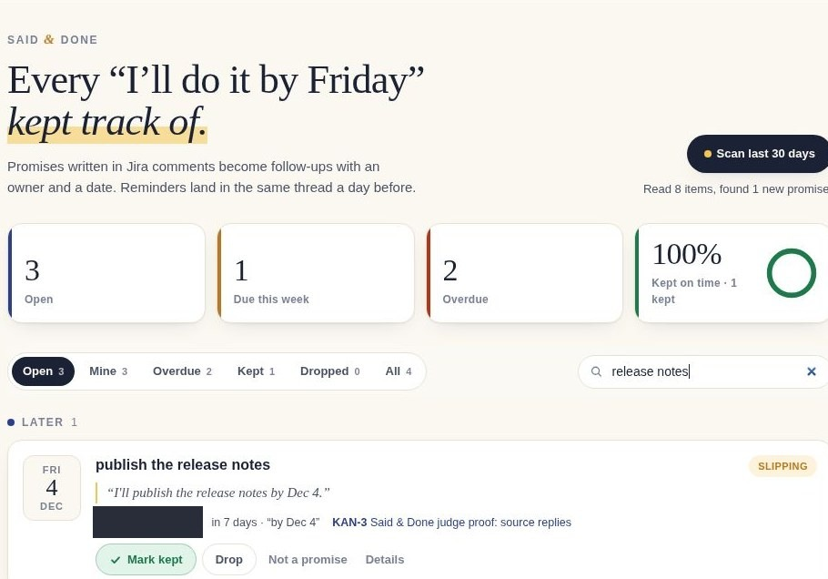
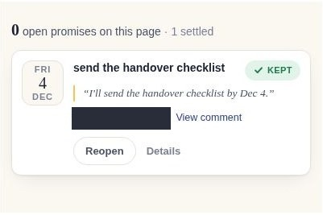
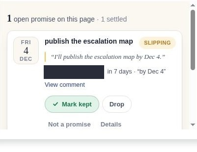

# Native Forge check on 28 November 2026

This check used the installed judge build in a signed-in test site with Jira
and Confluence. The comments and page were created for this check. The
screenshots are cropped and cover the test account's name and avatar.

## Jira

The following four comments were posted in order on the same test issue.

| Comment | Observed ledger state |
| --- | --- |
| “I'll send the updated budget by Friday.” | Tracked with a 4 December due date. |
| “Sent the updated budget.” | The budget promise moved to **Kept**. |
| “I'll publish the release notes by Dec 4.” | Tracked separately with a 4 December due date. |
| “I need more time to publish the release notes. Can we move it to Dec 7?” | The release-notes promise moved to **Slipping** and kept its original 4 December due date. |

**Scan last 30 days** reported eight items read and one new promise. These
counts include the site's existing test items.

## Confluence

A footer comment on a test page said “I'll send the handover checklist by Dec
4.” The direct threaded reply said “Sent the handover checklist.” The page
byline showed the handover promise as **Kept**. A separate scan in the
Confluence ledger reported 13 items read and one new promise.

After that scan, a second footer comment said “I'll publish the escalation map
by Dec 4.” Its direct reply said “I need more time to publish the escalation
map. Can we move it to Dec 7?” The byline marked the map **Slipping** with 4
December still displayed. The handover promise remained **Kept**.

## Reply timing checked in the repository

The [ingest tests](../../test/ingest.test.ts) backfill replies written on the
deadline day and the day after it, with the scan occurring later. They show
that on-time credit follows the source reply time. For Jira comments that
were edited, the tests use the timestamp of the revision containing the
reply. The late-reply case was exercised in the host tests.
